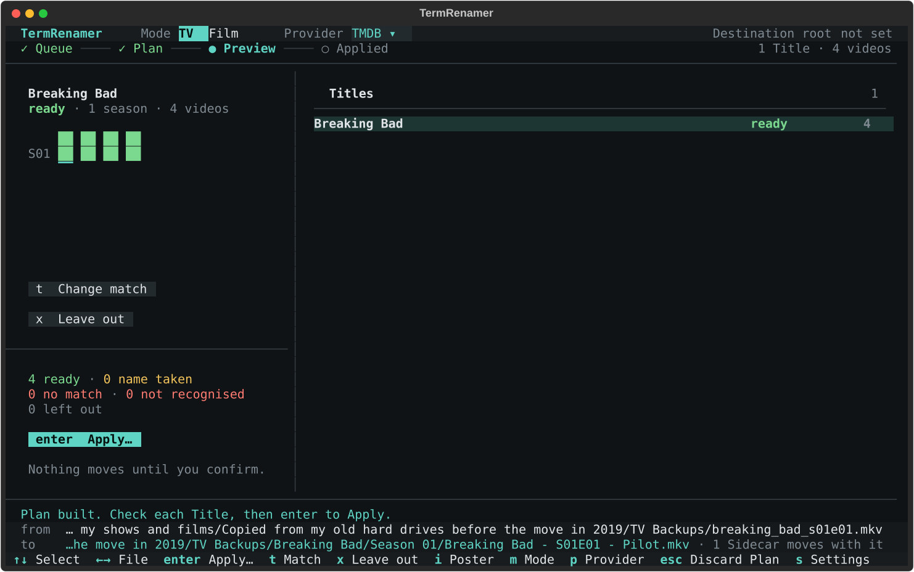

# TermRenamer

Rename TV and movie files from online metadata, with a preview before anything changes.

[](./pyproject.toml)
[](#status)
[](./LICENSE)
[](#install)



TermRenamer gives backups of your own media library-ready names. One screen
walks a batch through four Stages: Queue, Plan, Preview and Applied. You queue
your backups, build a Plan from online metadata, review it in the Preview, and
apply it. Nothing is renamed until you confirm, and the last Apply can be
undone.

## Example

By default, only the filename changes. A TV episode and its subtitle file:

| Before                    | After                               |
| ------------------------- | ----------------------------------- |
| `breaking_bad_s01e01.mkv` | `Breaking Bad - S01E01 - Pilot.mkv` |
| `breaking_bad_s01e01.srt` | `Breaking Bad - S01E01 - Pilot.srt` |

A film:

| Before                | After                   |
| --------------------- | ----------------------- |
| `the_matrix_1999.mkv` | `The Matrix (1999).mkv` |

Turn on **Folder rename** and the files also move into a folder tree. For TV,
turn on **Season folder** as well:

```text
The Matrix (1999)/
  The Matrix (1999).mkv

Breaking Bad/
  Season 01/
    Breaking Bad - S01E01 - Pilot.mkv
```

## Status

Pre-release. Behaviour and settings may change. Work on copies, or keep
backups, until you trust the results.

| Platform | State                                                        |
| -------- | ------------------------------------------------------------ |
| Windows  | Developed and tested here.                                   |
| macOS    | The test suite passes. The app itself is still being tested. |
| Linux    | Unverified.                                                  |

## Install

You need [uv](https://docs.astral.sh/uv/) and an API key from at least one
Provider: [TMDB](https://www.themoviedb.org/settings/api) (TV and films),
TheTVDB (TV) or OMDb (films). Any one is enough. TermRenamer needs Python 3.13
or newer. uv picks a matching Python and, by default, downloads one when your
machine has none.

```bash
uv tool install git+https://github.com/eunai/TermRenamer
termrenamer
```

Without any Provider key, the app exits with status 2. It prints the three key
settings, says one is enough, and gives the full path of the user settings file
it expects. See [Configure](#configure).

To show Posters, install the optional `posters` extra instead:

```bash
uv tool install "termrenamer[posters] @ git+https://github.com/eunai/TermRenamer"
```

Posters are drawn only in a terminal that draws Sixel or Kitty images, for
example iTerm2, Windows Terminal 1.22 or newer, kitty, WezTerm, Konsole, foot,
and xterm when it is set up for Sixel (`xterm -ti vt340`). Apple's Terminal,
GNOME Terminal and the Windows Console draw neither, and there the panel stays
hidden. The app checks the terminal once, at start.

To upgrade or remove it:

```bash
uv tool upgrade termrenamer
uv tool uninstall termrenamer
```

## Configure

Settings live in the **user settings file**: a file named `.env` in a
`termrenamer` folder under your per-user configuration folder.

| Platform        | Path                                                                                                        |
| --------------- | ----------------------------------------------------------------------------------------------------------- |
| Windows         | `%APPDATA%\termrenamer\.env` (under `AppData\Roaming` in your home folder when `APPDATA` is unset or empty) |
| macOS and Linux | `~/.config/termrenamer/.env` (or under `XDG_CONFIG_HOME` when it holds an absolute path)                    |

A `.env` in the folder you start the app from overrides the user settings
file. `TERMRENAMER_*` environment variables override both. A blank value
(`NAME=`) counts as not set, so a value from a lower source still applies. The
app only reads these files and never writes them.

A minimal file sets one Provider key, for example:

```dotenv
TERMRENAMER_TMDB_API_KEY=...
```

The app starts when at least one of `TERMRENAMER_TMDB_API_KEY`,
`TERMRENAMER_TVDB_API_KEY` and `TERMRENAMER_OMDB_API_KEY` is set. A TheTVDB
subscriber PIN alone is not a key. A Provider whose key is missing is marked
"no key" in the header; building a Plan with it names the setting to add and
builds no Plan. An invalid number, on-off value, Name taken or Theme stops the
app at start with exit status 2 and a message that names the setting.

The settings:

| Setting                                 | Default  | Purpose                                                                                |
| --------------------------------------- | -------- | -------------------------------------------------------------------------------------- |
| `TERMRENAMER_TMDB_API_KEY`              | none     | TMDB key. Needed to build a Plan with TMDB.                                            |
| `TERMRENAMER_TVDB_API_KEY`              | none     | TheTVDB v4 key. Needed to build a Plan with TheTVDB.                                   |
| `TERMRENAMER_TVDB_SUBSCRIBER_PIN`       | none     | TheTVDB subscriber PIN, for accounts that need one. Not a key on its own.              |
| `TERMRENAMER_OMDB_API_KEY`              | none     | OMDb key. Needed to build a Plan with OMDb.                                            |
| `TERMRENAMER_ENABLE_FOLDER_RENAME`      | `false`  | Move files into show or film folders, not just rename the filename.                    |
| `TERMRENAMER_ENABLE_SEASON_FOLDERS`     | `false`  | Place TV episodes in `Season NN` folders. Needs Folder rename.                         |
| `TERMRENAMER_FILM_DEST_FOLDER`          | unset    | Destination root for film output. Used only when Folder rename is on.                  |
| `TERMRENAMER_TV_DEST_FOLDER`            | unset    | Destination root for TV output. Used only when Folder rename is on.                    |
| `TERMRENAMER_NAME_TAKEN`                | `suffix` | When a new name is taken: `suffix` adds a number, `skip` leaves the file.              |
| `TERMRENAMER_THEME`                     | `dark`   | Screen colours: `dark` or `light`.                                                     |
| `TERMRENAMER_SHOW_POSTERS`              | `true`   | Show the selected Title's Poster, when the `posters` extra is installed and it can be. |
| `TERMRENAMER_CACHE_DB_PATH`             | unset    | Path of a SQLite metadata cache. The cache is off until you set it.                    |
| `TERMRENAMER_HTTP_TIMEOUT_SECONDS`      | `30`     | Timeout of one request to a Provider, in seconds.                                      |
| `TERMRENAMER_HTTP_MAX_ATTEMPTS`         | `4`      | Attempts for one request, at least 1.                                                  |
| `TERMRENAMER_HTTP_BACKOFF_BASE_SECONDS` | `0.5`    | Wait before the second attempt, in seconds. It doubles with each attempt, up to 60.    |
| `TERMRENAMER_HTTP_JITTER`               | `true`   | Shorten each backoff wait by a random amount, up to half. A `Retry-After` wait is not. |
| `TERMRENAMER_LOG_FILE`                  | unset    | No effect yet ([#4](https://github.com/eunai/TermRenamer/issues/4)).                   |

The on and off values are `true` or `false`, `1` or `0`, `yes` or `no`, and `on`
or `off`. [`.env.example`](.env.example) shows each setting with a
comment. The **Settings** screen (`s`) holds the two Destination roots, Folder
rename, Season folder, Name taken, Show posters and Theme. Its changes last for
the current session only, and the app never writes the user settings file.

## Use

1. Run `termrenamer`. A row under the header names the four Stages and marks
   the one you are at. The header shows the Mode (TV or Film), the Provider
   and the Destination root.
2. **Queue.** Add your backups with `a` (a file) or `f` (a folder). A path that
   is already queued is refused, and `c` clears the queue. Pick TV or Film with
   `m` and a Provider with `p`; one without a key is marked "no key". Nothing is
   looked up until you build the Plan.
3. **Plan.** `b` builds the Plan. Each Title shows as waiting, looking up,
   found or no match, with how many files are looked up and how fast. `Esc`
   cancels: the queue is kept and nothing is renamed. If the Provider cannot be
   reached or rejects the key, the build stops with the Provider's message.
4. **Preview.** One row per Title, with its status and its number of videos; a
   video whose name cannot be read is a row of its own. A column shows the
   selected Title and a cell for each of its videos. `←` `→` select a file, and
   the footer shows its current path and its new path. `t` picks a different
   Match for the Title. `x` leaves the selected file out of the Plan, and `x`
   again puts it back. `Esc` discards the Plan and keeps the queue.
5. Press `Enter`. The Apply confirm says what Apply will do. `y` or `Enter`
   renames; `n` or `Esc` goes back with nothing changed.
6. **Applied.** The Stage counts the videos renamed, skipped and failed, and
   any that already had their names or were left out. It lists each video
   skipped, failed or left out with the reason, each Sidecar not renamed while
   its video was renamed or already had its name, and each Straggler not
   merged. A video that already had its name is only counted, and a Sidecar
   skipped with its video is not listed on its own; the Logs (`l`) have every
   outcome. `u` undoes the last Apply, and `n`
   starts a new batch with an empty queue.

`l` shows the Logs and `?` lists the keys. A button on the screen shows its key,
and clicking it does what the key does. Clicking a row of the Queue's Sources, of
the Plan's Titles or of the Preview's Titles selects it, as `↑` `↓` do.

Keys:

| Key     | Where                                 | Action                                                              |
| ------- | ------------------------------------- | ------------------------------------------------------------------- |
| `a`     | Queue                                 | Add a file                                                          |
| `f`     | Queue                                 | Add a folder                                                        |
| `c`     | Queue                                 | Clear the queue                                                     |
| `b`     | Queue                                 | Build the Plan                                                      |
| `↑` `↓` | Queue                                 | Select a Source                                                     |
| `↑` `↓` | Plan, Preview                         | Select a Title                                                      |
| `←` `→` | Preview                               | Select a file of the Title                                          |
| `t`     | Preview                               | Open the Match picker (`←` `→` or `↑` `↓`, `1` to `3`, `Enter`, `/` to type, `Esc`) |
| `x`     | Preview                               | Leave the selected file out, or put it back                         |
| `Enter` | Preview                               | Apply, then `y` or `Enter` to confirm, `n` or `Esc` to go back      |
| `Esc`   | Plan                                  | Cancel the build                                                    |
| `Esc`   | Preview                               | Discard the Plan                                                    |
| `u`     | Applied                               | Undo the last Apply, then `y` to put back, `n` or `Esc` to keep it  |
| `n`     | Applied                               | New batch                                                           |
| `m`     | Queue, Preview                        | Change Mode (TV or Film)                                            |
| `p`     | Queue, Preview                        | Change Provider                                                     |
| `s`     | Queue, Preview, Applied               | Settings (`↑` `↓`, `Enter` or Space, `Esc`)                         |
| `i`     | Any Stage or view, not a text field   | Hide or show Posters                                                |
| `l`     | Any Stage or view, not a text field   | Logs                                                                |
| `?`     | Any Stage or view, not a text field   | Help                                                                |
| `q`     | Any Stage or view, not a text field   | Quit (`Ctrl+Q` quits too)                                           |
| `Esc`   | A dialog or view                      | Close it                                                            |

`m` and `p` at the Preview discard the Plan, and `s` does too when you change a
setting the Plan was built with. While a Plan is being built or applied, `s`,
`m` and `p` say why they wait. `l`, `?`, `q` and `i` do nothing in a dialog (the
Apply and Undo confirms, the Match picker, the file and folder dialogs).

## Features

- **Four Stages on one screen.** Queue, Plan, Preview and Applied, with a row
  that marks the current one and a footer that lists the keys that work now.
  While an Apply or an Undo runs, it lists none that refuse meanwhile. When it
  is too narrow for every hint, it drops Poster, Logs, Provider, Mode, Settings
  and Quit first, in that order, then the selection keys, then the Stage's own
  keys from the last; `? Help` stays.
- **Plan, Preview, then Apply.** No rename runs until you confirm. The Apply
  confirm counts the videos renamed and skipped, names each Sidecar skipped
  while its video moves, and says that nothing has been renamed yet.
- **TV and Film Modes.** TV uses TMDB or TheTVDB v4. Film uses TMDB or OMDb.
  OMDb is a Provider you select, not an automatic fallback. At start, and when
  you change Mode, the Provider is the first of that Mode that has a key, or
  TMDB, marked "no key", when none of that Mode has one. The app starts in TV
  Mode, so with only an OMDb key the header shows `TMDB (no key)` until `m`
  changes to Film, where OMDb is selected.
- **Source queue.** Add files with `a` and folders with `f`. A folder is
  searched, with its subfolders, for `.mkv`, `.mp4`, `.avi`, `.webm` and `.m4v`
  videos. A folder and a file inside it can both be queued: the file is planned
  once. A queued file or folder that has gone is reported in the Logs and the
  rest of the queue is planned. The search never enters a symbolic link or a
  Windows junction to a folder, so no video behind one is planned; a video that
  is a symbolic link is planned and renamed as the link. A companion file (a
  file whose name starts with `._`, which macOS writes beside a file on exFAT,
  FAT32 and some network shares) is never a video, a Sidecar or a Straggler:
  Apply leaves companion files to the filesystem. If a dialog cannot
  read a folder, or the file dialog cannot look at a path you typed, it stays
  open and says why.
- **A Plan you can watch and cancel.** While the Plan is built, each Title is
  listed as waiting, looking up, found or no match, and a strip shows how many
  files are looked up, the matched and unmatched counts and the lookups per
  second.
- **Preview.** One row per Title with its status (ready, name taken, no match,
  left out) and its number of videos; a video whose name cannot be read is a
  row of its own, marked not recognised, and Apply leaves it where it is. A
  summary counts the videos by status. Names and paths are shown as written,
  square brackets and backslashes included.
- **Pick a different Match.** `t` opens the Match picker: the current Match, the
  Provider's next Candidate and "Type a title". While Posters show, it is a wide
  dialog of up to three tiles side by side, each Candidate's Poster with its name,
  year and key under it, and the typing field in the last tile; otherwise it is
  a plain list. `←` `→` or `↑` `↓` move, `1` to `3` or `Enter` choose, `/` goes
  to typing and `Esc` closes it with nothing changed. Typing searches the
  Provider again; a four-digit year at the end of the text is the year. A pick
  for a film renames its files from the Candidate's title and year. A pick for a
  show looks its episode titles up again, and `Esc` abandons it. A not
  recognised film can be matched this way; a not recognised TV file cannot yet
  ([#14](https://github.com/eunai/TermRenamer/issues/14)). A pick holds for this
  Plan only: build the Plan again and it starts afresh.
- **Leave a file out.** `x` leaves a video, with its Sidecars, out of the Plan;
  any video can be left out, one with no match or not recognised too, and it
  stays left out when it is given a Match. Apply does not touch it, and it is
  reported as left out, not as skipped. Every new name is worked out again, so a
  name that only that file had taken is free for the next one.
- **Undo.** After Apply, `u` puts the last Apply back: files, Sidecars and
  Stragglers, and the folders Apply removed, last move first, and it removes a
  folder Apply made when Undo leaves it empty. It never replaces anything. A
  file goes back only if it is still at its new place with the size and
  modification time Apply recorded and its old name is free. A file of a folder
  Straggler whose folder Apply left at its old place goes back into that folder
  only while it is still the folder Apply left; the Logs say why any other file
  stayed. Undo is offered once for each Apply, and only when that
  Apply moved a file, removed a folder or made one. The record is kept in
  memory, so it is gone when you start a new batch or quit. After Undo the Queue
  Stage shows the same Sources.
- **Name taken.** When a new name is already used, by something at that path
  or by an earlier file of the same Plan, the file is marked "name taken". The
  Name taken setting (`TERMRENAMER_NAME_TAKEN`, or the Settings screen) decides
  what happens: `suffix`, the default, adds a number such as ` (1)`; `skip`
  leaves the file, and its Sidecars, where they are. A Sidecar whose own name
  is taken is skipped alone under `skip` while its video moves. The footer
  says what will happen to the selected file when its name is taken. The
  Applied Stage lists every skipped file with its reason. If a file or folder
  appears at a destination after the Preview, Apply skips that file or folder. Nothing
  is ever overwritten.
- **Folder layouts.** With Folder rename on, files move into show or film
  folders, with optional `Season NN` folders for TV. Destination roots apply
  only when Folder rename is on; when none is set, the tree is built in the
  queued folder, or in the folder of a queued file.
- **Stragglers.** With Folder rename on, the Plan lists the Stragglers it will
  merge: the files and folders left in a queued folder, or a folder inside one,
  after a video moves out of it. Apply merges them into the target folder, and
  a folder moves as its files. A video with no match, not recognised or
  skipped for a taken name stays in its folder with its Sidecars. The files
  beside a queued file stay where they are.
- **Sidecars.** `.srt`, `.nfo`, `.sub` and `.idx` files move with the video in
  the same folder whose filename matches theirs apart from the extension,
  ignoring case. A Sidecar is renamed only if its video was renamed or already has its name.
- **Safe moves.** Apply claims each new name with the move itself, so nothing
  that appears at a name while Apply runs is replaced. A symbolic link or
  junction to a folder is moved as itself, and Apply never enters it. Apply goes
  through a folder that was a symbolic link or junction when the Plan was built
  only while it is that same link, leading to the same folder; a folder that
  became a link after the Plan was built is not entered, and its files are
  skipped or fail with that reason. Where a file cannot be moved by a rename or
  a hard link (another drive, or a filesystem with no hard links, such as exFAT
  and many network shares), Apply copies it, checks the copy against the
  original and then removes the original, which takes as long as a copy. On
  Windows that copy is written as `.termrenamer-<16 hex>.part` in the new folder
  and then renamed. A junction cannot be moved to another drive.
- **Two themes.** Dark and light teal, chosen with `TERMRENAMER_THEME` or on
  the Settings screen.
- **Posters.** With the `posters` extra installed and a terminal that draws
  images, the Plan and Preview show the selected Title's Poster in a framed
  panel with the Provider's name on its border. `i` or the Settings screen
  hides or shows it for the session; `TERMRENAMER_SHOW_POSTERS=false` starts
  with it hidden. The panel needs a screen of at least 100 columns by 35 rows;
  on a smaller one it is hidden. A Title with no Poster shows its name and
  "no poster". Posters are downloaded from TMDB's or TheTVDB's image host when
  a Title is selected at the Preview, the first one as the Preview opens, and
  when the Match picker shows a Candidate, never while the Plan is built, and
  kept for 30 days in a `termrenamer/posters` folder in your per-user cache
  folder (`%LOCALAPPDATA%` on Windows, `~/.cache` or `XDG_CACHE_HOME`
  elsewhere). OMDb gives no Posters. If that folder is a link, or lies outside
  the cache folder, no Poster file is read, written or deleted: every Poster
  shows "no poster" and the Logs say why once.
- **Logs.** `l` opens the last 5000 log lines of the session, which include the
  messages the screen gave and what happened to each file Apply and Undo
  handled.
- **Metadata cache.** Setting `TERMRENAMER_CACHE_DB_PATH` switches on a SQLite
  cache for TMDB, TheTVDB and OMDb lookups. Each Provider's answers are kept
  apart, and a search that found nothing is not stored. It is safe to delete.
- **Resilient requests.** Bounded retries, backoff, and `Retry-After`
  handling.

## Known limitations

- `TERMRENAMER_LOG_FILE` has no effect yet
  ([#4](https://github.com/eunai/TermRenamer/issues/4)).
- A terminal that draws neither Sixel nor Kitty images has no Posters and no
  panel; a picture made of character blocks is planned
  ([#13](https://github.com/eunai/TermRenamer/issues/13)).
- A not recognised TV file cannot be matched by hand; typing its season and
  episode is planned ([#14](https://github.com/eunai/TermRenamer/issues/14)).
- Apply and Undo cannot defend against another program that changes the same
  file or name between their last check and the very next call, or one that
  deletes or writes over a name they have claimed.

## Troubleshooting

See the [runbook](docs/runbook.md) for safe-rerun commands and common Provider
problems.

## Changelog

See [CHANGELOG.md](CHANGELOG.md) for what changed in each version.

## Contributing

Report bugs and share ideas in
[GitHub Issues](https://github.com/eunai/TermRenamer/issues). A pull request is
welcome once an issue agrees the change.

To set up from a clone, with [uv](https://docs.astral.sh/uv/):

```bash
uv sync
uv run pytest -v --cov
uv run ruff check .
uv run ruff format --check .
uv run mypy src
uv run termrenamer
```

Start the app from the repository root, so it reads the clone's `.env`.
`uv sync --extra posters` adds the image package that draws Posters, and
`uv sync` removes it again.

`--cov` measures coverage of `src/termrenamer` and fails the run below 85%.
Without it, `uv run pytest` runs the tests only, so you can run one test file
on its own. CI runs the same checks on each pull request and each push to
`main`, on Linux and Windows, once without and once with the `posters` extra.
To make the screenshot above again, run `uv run python scripts/render_preview.py`
from the repository root; it needs no network, API key or settings file.

The project is developed with AI coding assistants. The rules they follow live
in [`AGENTS.md`](AGENTS.md) and [`docs/agents/`](docs/agents/).

## Attribution

When you use **TheTVDB** for TV metadata, data comes from their API. Per [TheTVDB’s licensing terms](https://thetvdb.com/api-information#attribution): [Metadata provided by TheTVDB. Please consider adding missing information or subscribing.](https://thetvdb.com/)

This product uses the TMDB API but is not endorsed or certified by TMDB.

Film metadata can also come from [OMDb](https://www.omdbapi.com/).

Posters come from TMDB's and TheTVDB's image hosts. The Help screen (`?`) shows
the TMDB and TheTVDB credits too.

## License

TermRenamer is licensed under the **GNU General Public License v3.0**. See
[LICENSE](LICENSE) for the full text.
